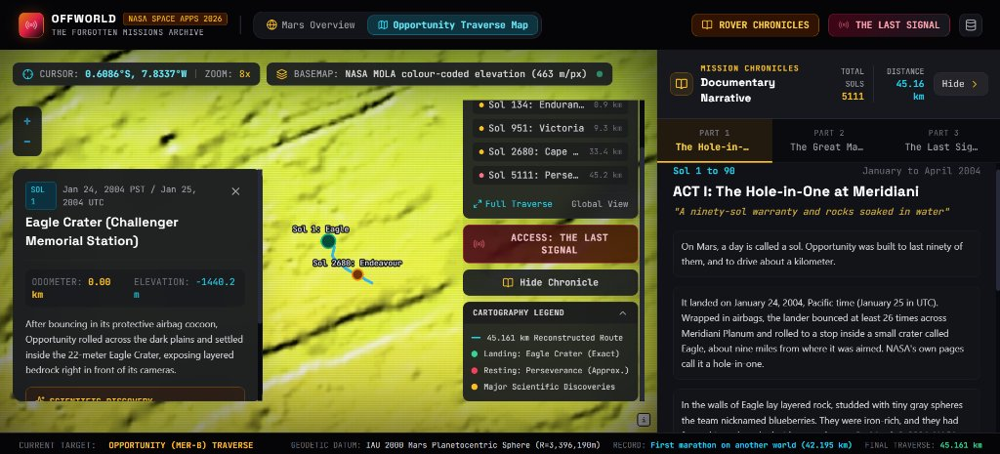
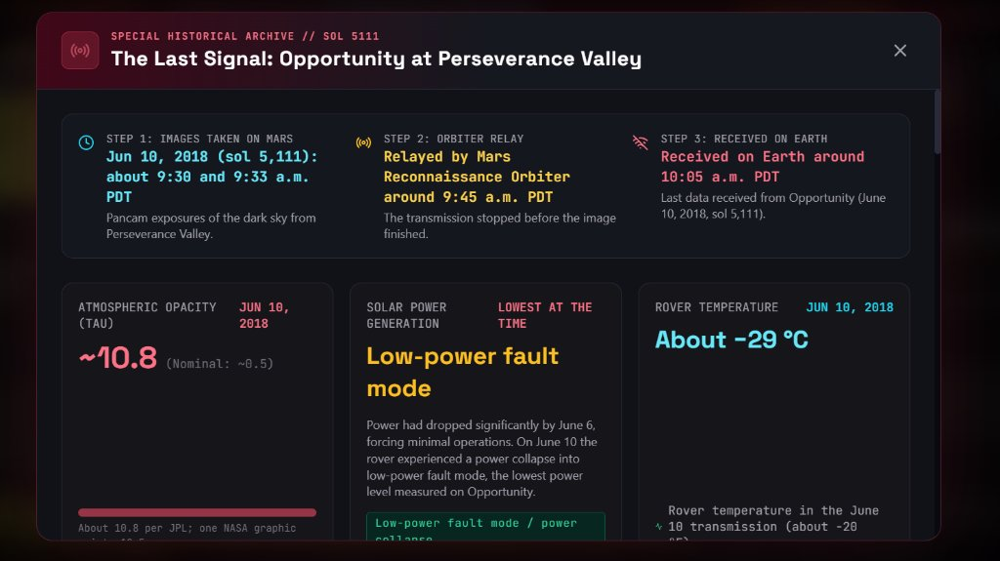
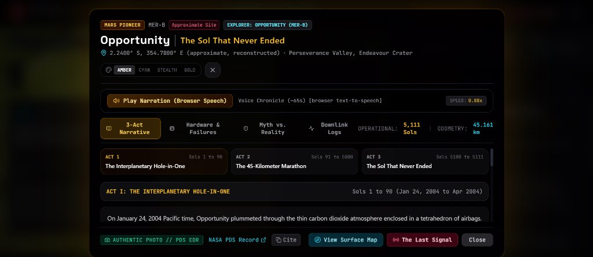

# OFFWORLD: The Forgotten Missions Archive

Every mission ends. Its discoveries remain.

NASA Space Apps Challenge 2026 Submission

**Live demo: https://offworld-the-forgotten-missions-arc.vercel.app/**

## About

The Mars Exploration Rover Opportunity (MER-B) landed on Mars on January 24, 2004, Pacific time (January 25 UTC). Originally designed for a 90-sol primary warranty, Opportunity continued operating across the plains of Meridiani Planum for 5,111 sols (over 14 Earth years) and traversed a total distance of 45.161 kilometers.

OFFWORLD is an interactive documentary and planetary exploration archive dedicated to preserving the real telemetry, scientific milestones, and historical conclusion of Opportunity. Built with verified NASA datasets, the application combines calibrated cartographic elevation mapping with chronological storytelling and primary source auditing. It provides an educational interface for students, researchers, and space enthusiasts to inspect Opportunity's surface route, telemetry logs, hardware diagnostic history, and final transmission sequence.

## Screenshots

### Opportunity Traverse Map

Opportunity Traverse Map across Meridiani Planum with interactive waypoints, trajectory presets, and MOLA elevation data.

### Mission Chronicles Panel

Mission Chronicles panel displaying the three-act narrative alongside the active surface traverse map.

### The Last Signal Archive

The Last Signal archive documenting the sol 5,111 transmission timeline, atmospheric opacity, and low-power fault mode.

### NASA Primary Sources and Data Provenance Register

NASA Primary Sources and Data Provenance register auditing Photojournal imagery, PDS records, and 14 CFR Part 1221 compliance.

### Rover Chronicles Dossier

Rover Chronicles dossier featuring three-act narrative, hardware failure diagnostics, myth verification, and telemetry downlink logs.

### Mars Overview

Mars Overview featuring a 2D illustrative rotating globe indicating Opportunity's approximate landing coordinates.

## Features

- **Opportunity Traverse Map:** Interactive surface cartography powered by OpenLayers using the NASA MOLA colour-coded elevation basemap at 463 meters per pixel, featuring interactive waypoints with Earth date, sol, odometer distance, elevation, and site descriptions, supported by a collapsible Cartography Legend and a maximum zoom capped at 8 to prevent pixelation.
- **Mission Chronicles and Rover Chronicles:** Comprehensive documentary story covering Opportunity's journey through a three-act narrative (Act I: The Hole-in-One at Meridiani, Act II: The Great Marathon, Act III: The Last Signal), accompanied by dedicated tabs for Hardware and Failures, Myth vs. Reality, and Downlink Logs, complete with browser text-to-speech narration.
- **The Last Signal Archive:** Sol 5,111 (June 10, 2018) historical record reconstructing the sequence of final Pancam exposures on Mars (~9:30 and ~9:33 a.m. PDT), MRO relay pass (~9:45 a.m. PDT), Earth ground station reception (~10:05 a.m. PDT), atmospheric opacity (tau ~10.8), operating temperature (~ -29 degrees Celsius), and power status in low-power fault mode.
- **NASA Primary Sources and Data Provenance Register:** Slide-out verification drawer cataloging all primary NASA Photojournal PIA records, PDS Analyst's Notebook references, and formal citation metadata for academic and educational review.
- **Mars Overview:** Celestial global perspective rendering a 2D canvas of Mars labelled "Illustrative rendering of Mars, not NASA imagery", highlighting Opportunity's reconstructed landing coordinates and core mission milestones.

## Honest Data Labelling

- **Reconstructed vs. Exact Locations:** Opportunity's touchdown point at Eagle Crater is verified exact via NASA PDS RMC Site 000 (-1.9462 degrees S, 354.4734 degrees E), while the 45.161 km traverse route and final resting position in Perseverance Valley (-2.2400 degrees S, 354.7800 degrees E) are derived from published mission telemetry and explicitly marked as approximate reconstructed positions.
- **Elevation Basemap vs. Photography:** The surface map is clearly identified as a NASA MOLA colour-coded shaded relief elevation model from Mars Global Surveyor, not visible-light photography, and the 2D overview globe carries an explicit visual notice stating it is an illustrative rendering rather than NASA imagery.
- **Sourced Imagery and Telemetry:** Photographic records cite authentic NASA JPL Photojournal identifiers, and popular misconceptions (including journalistic paraphrases) are separated from the actual raw binary engineering packets and low-power fault states transmitted by the spacecraft.

## Testing

The codebase includes end-to-end automated layout and interaction tests using Playwright:
- **Responsive Viewport Non-Overlap Checks:** Automated validation across six target viewport resolutions (1918x835, 1534x668, 1366x640, 1024x700, 768x1024, and 390x800) evaluating bounding box coordinates with the Mission Chronicles sidebar both open and closed, enforcing zero console errors and zero element overlaps exceeding 2 pixels between UI components (legend, navigation panel, zoom controls, attribution button, waypoint card, coordinate chips, and footer).
- **Traverse Route Measurement:** Verification of route pixel geometry at initial zoom 4.5 confirming waypoint markers and decluttered labels render without collisions.
- **Overview and Modal Verification:** Automated testing of view switching, modal dialogues, and honest labelling disclaimers.

## Tech Stack

- React 19.0.0
- React DOM 19.0.0
- TypeScript 5.7.3
- Vite 6.2.1
- Tailwind CSS 3.4.17
- OpenLayers (ol) 10.4.0
- lucide-react 1.16.0
- clsx 2.1.1
- tailwind-merge 3.0.2
- Playwright (@playwright/test) 1.65.1

## Run Locally

```bash
# Clone repository
git clone https://github.com/Charmy996/OFFWORLD-The-Forgotten-Missions-Archive.git
cd OFFWORLD-The-Forgotten-Missions-Archive

# Install dependencies
npm install

# Start local development server (runs on port 3000 as configured in vite.config.ts)
npm run dev

# Run TypeScript check and production build
npm run build
```

## NASA Data and Credits

- **NASA Solar System Treks:** Mars Trek MOLA Color Shaded Relief global equirectangular tile service, layer `Mars_MGS_MOLA_ClrShade_merge_global_463m` (463 meters per pixel), NASA Jet Propulsion Laboratory and Goddard Space Flight Center (https://trek.nasa.gov/).
- **NASA Planetary Data System (PDS) Analyst's Notebook:** Mars Exploration Rover Opportunity (MER-B) rover motion counter (RMC) archives, sol-by-sol traverse telemetry, and science instrumentation records, Washington University in St. Louis (https://an.rsl.wustl.edu/mer/merb/).
- **NASA Jet Propulsion Laboratory Photojournal:** Calibrated imaging products referenced in the archive:
  - PIA18885: Clues to Wet History in Texture of a Martian Rock (Eagle Crater)
  - PIA06739: Opportunity Catches Its Shadow on Sol 180 (Meridiani Planum)
  - PIA09104: Panorama from "Cape Verde" at Victoria Crater
  - PIA16703: Matijevic Hill Panorama at Endeavour Crater Rim (Smectite clay minerals)
  - PIA19158: Opportunity's Marathon Journey (Marathon Valley)
  - PIA22909: Opportunity's Legacy Pan (True Color) in Perseverance Valley
  - PIA22930: Last Images Opportunity Took (Atmospheric tau thumbnails)
  - PIA22929: Opportunity's Last Message (Final incomplete Pancam frame)
- **14 CFR Part 1221 Compliance Note:** OFFWORLD is an independent educational project developed for the NASA Space Apps Challenge 2026. Pursuant to 14 CFR Part 1221, official NASA seals, insignias, and logos are not used, and no NASA endorsement is implied.

## AI Tools Used

In accordance with NASA Space Apps Challenge rules:
- **Antigravity** (Google DeepMind): Used for agentic code implementation, primary source cross-checking, and build and test verification.
- **Claude** (Anthropic): Used for pre-hackathon research synthesis, story outline structuring, and design review.

The human OFFWORLD team directed all development, authored the project requirements, and verified all technical and historical facts against official NASA mission logs and scientific publications.

## Team and License

Team of 4:
- Charmy Parekh
Team members: (add names)

License: MIT (see LICENSE).
