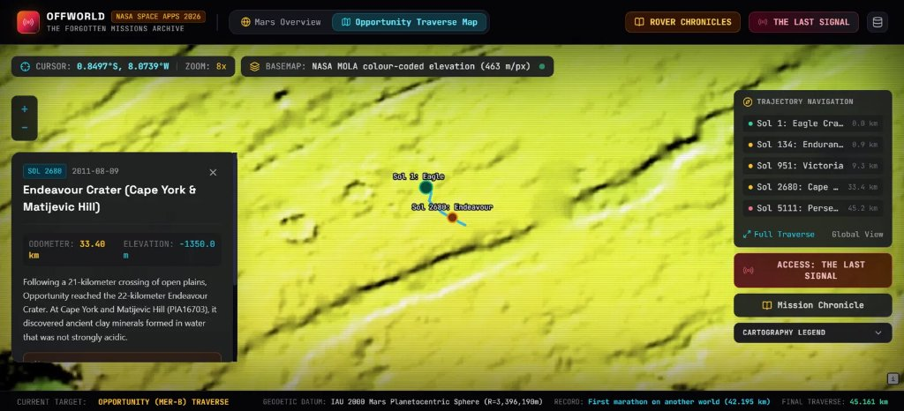
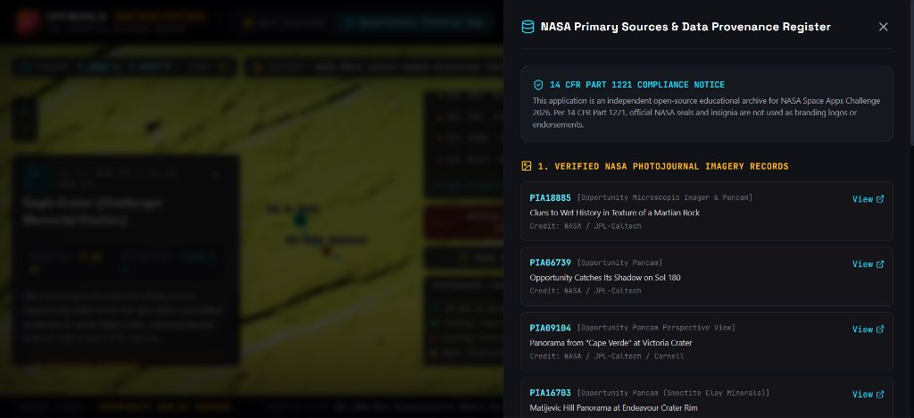
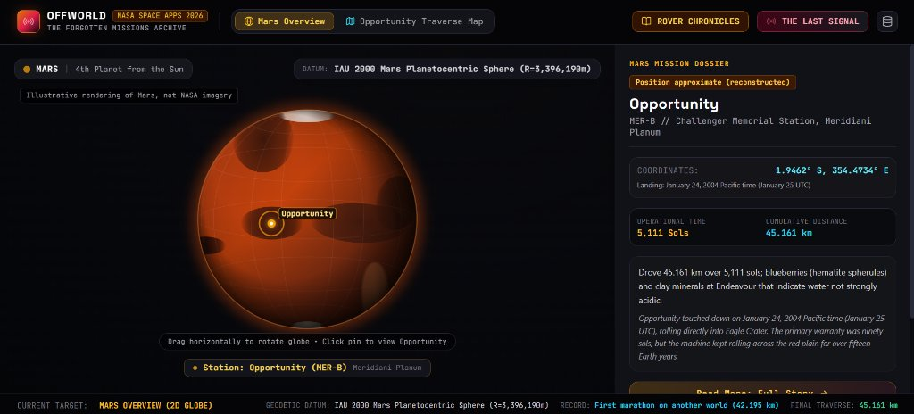

# OFFWORLD: The Forgotten Missions Archive

NASA International Space Apps Challenge 2026 Submission

OFFWORLD is an interactive planetary exploration chronicle dedicated to humanity's longest-operating extraterrestrial surface missions, focused on the Mars Exploration Rover Opportunity (MER-B). Built on verified NASA telemetry and calibrated planetary cartography, OFFWORLD reconstructs Opportunity's 15-year expedition across Meridiani Planum.

---

## Interface Screenshots

### Opportunity Traverse Map

*Opportunity Traverse Map*

### Mission Chronicles panel (3-act narrative)

*Mission Chronicles panel (3-act narrative)*

### The Last Signal archive (sol 5,111)

*The Last Signal archive (sol 5,111)*

### NASA Primary Sources & Data Provenance Register

*NASA Primary Sources & Data Provenance Register*

### Rover Chronicles dossier

*Rover Chronicles dossier*

### Mars Overview (2D illustrative globe)

*Mars Overview (2D illustrative globe)*

---

## Architecture and Key Capabilities

### 1. Opportunity (MER-B) Surface Traverse Map
- Powered by OpenLayers with NASA's verified Mars Trek MOLA colour-coded elevation basemap (`Mars_MGS_MOLA_ClrShade_merge_global_463m`, 463 m/px), capped at native zoom 7 for smooth interpolation without tile gaps.
- Equirectangular projection using IAU 2000 Mars Planetocentric datums.
- Real-time cursor coordinates in areographic latitude and longitude.
- Complete 45.161-kilometer reconstructed vector trajectory from Eagle Crater to Perseverance Valley.
- Non-overlapping waypoint labels, honest elevation cartography labels, and fully responsive layout across desktop and mobile.

### 2. Verified Landing and Resting Coordinates
- **Touchdown (Sol 1):** Challenger Memorial Station in Eagle Crater (`-1.9462° S, 354.4734° E`, Jan 24, 2004 PST / Jan 25, 2004 05:05 UTC) [Exact, PDS RMC Site 000].
- **First Marathon (Sol 3968):** Surpassed 42.195 km on March 24, 2015 along the rim of Endeavour Crater.
- **Final Resting Site (Sol 5111):** Perseverance Valley on the rim of Endeavour Crater (`-2.2400° S, 354.7800° E`) [Approximate, reconstructed].

### 3. Verified NASA Photojournal Imagery
All photographic assets have been audited against NASA Jet Propulsion Laboratory Photojournal archives:
- **PIA18885:** Clues to wet history in texture of Martian rock at Eagle Crater (Pancam and Microscopic Imager).
- **PIA06739:** Opportunity catches its own shadow on Sol 180 during plains traverse.
- **PIA09104:** Panorama from "Cape Verde" promontory rising over the floor of Victoria Crater.
- **PIA16703:** Matijevic Hill panorama at Cape York (Endeavour Crater rim; discovery of ancient smectite clay minerals).
- **PIA19158:** Opportunity's Marathon Journey: traverse map and vista overlooking Marathon Valley.
- **PIA22909:** Opportunity's Legacy Pan (True Color) 360-degree panorama in Perseverance Valley.
- **PIA22930:** Subsequent atmospheric tau thumbnails successfully received via orbiter relay.
- **PIA22929:** "Opportunity's Last Message", the final incomplete Pancam frame cut off before completion.

### 4. Sol 5111 "The Last Signal" Archive
- Reconciled sequential timeline:
  - Mars Pancam exposures at ~9:30 and ~9:33 a.m. PDT (June 10, 2018).
  - Mars Reconnaissance Orbiter (MRO) UHF relay pass at ~9:45 a.m. PDT.
  - Earth ground station reception at ~10:05 a.m. PDT (transmission stopped before the image finished).
- Power state: qualitative low-power fault mode / catastrophic power collapse as solar insolation was choked by the planet-encircling dust storm.
- Atmospheric opacity (tau) measured at 10.8 (one NASA graphic cites 10.5).
- Operating temperature near -29 °C.
- Documented team assumption: by June 12, 2018, battery levels depleted, triggering low-power sleep mode with mission clock.
- NASA Fact-Check Matrix: side-by-side verification debunking popular online myths regarding Opportunity.
- Clarification that science journalist Jacob Margolis coined the poetic summary on Twitter on June 13, 2018, while Opportunity transmitted raw binary engineering packets.

### 5. Interactive Rover Story Chronicle
- **3-Act Narrative Structure:** Deep documentary-grade story arcs (Act I: The Eagle Has Landed, Act II: The Iron & The Rim, Act III: The Dust & The Silence) covering Opportunity's 15-year expedition.
- **Spoken Narration (Browser Speech):** Native browser text-to-speech (Web Speech API, not a recorded voice) with speed control, active voice detection, and complete silence when no voices are available.
- **Dynamic Thematic Modes:** Live switchable styling themes (`Amber CRT`, `Cyan Telemetry`, `Stealth Dark`, `Archival Gold`) adjusting glowing borders, telemetry scanlines, and buttons.
- **Hardware Failure Anatomy:** Deep engineering diagnostic dossiers detailing historical component failures and remote recovery workarounds (steering actuator jam, right-front wheel heater draining power, and flash memory wear-out).
- **Downlink Telemetry Logs & Citation Exporter:** Verified event logs and automated academic citation copying.

### 6. Media Provenance and Compliance
- Spoken chronicle narration uses native browser text-to-speech (Web Speech API). No synthesized audio effects, oscillators, or ambient soundbeds are bundled.
- 100% royalty-free and copyright compliant. Commercial recordings (including Billie Holiday's master recording of "I'll Be Seeing You") are strictly excluded. Press accounts reported Billie Holiday's song was transmitted or played during final attempts, but NASA's official release does not mention the song; final recovery commands went out Feb 12, 2019 via the 70-meter Goldstone antenna.
- Conforms to NASA Regulation 14 CFR Part 1221 (no unauthorized NASA logos or implied endorsements).

---

## Data Sources and Credits

- **NASA Solar System Treks:** Mars Orbiter Laser Altimeter (MOLA) colour-coded elevation global equirectangular tile service (`Mars_MGS_MOLA_ClrShade_merge_global_463m`), NASA Jet Propulsion Laboratory / Goddard Space Flight Center ([trek.nasa.gov](https://trek.nasa.gov/)).
- **NASA Planetary Data System (PDS) Analyst's Notebook:** Mars Exploration Rover Opportunity (MER-B) rover motion counter (RMC) archives, sol-by-sol traverse telemetry, and science instrumentation records, Washington University in St. Louis ([an.rsl.wustl.edu/mer/merb/](https://an.rsl.wustl.edu/mer/merb/)).
- **NASA Jet Propulsion Laboratory Photojournal:** Calibrated imaging products including `PIA18885` (Eagle Crater Rock Texture), `PIA06739` (Sol 180 Shadow), `PIA09104` (Victoria Crater Cape Verde), `PIA16703` (Matijevic Hill Clay Minerals), `PIA19158` (Marathon Journey), `PIA22909` (Legacy Panorama), `PIA22930` (Atmospheric Tau Thumbnails), and `PIA22929` (Opportunity's Last Message) ([photojournal.jpl.nasa.gov](https://photojournal.jpl.nasa.gov/)).
- **14 CFR Part 1221 Compliance Note:** OFFWORLD is an independent educational hackathon submission developed for the NASA International Space Apps Challenge 2026. Pursuant to 14 CFR Part 1221 (*The NASA Seal and Other Devices*), official NASA insignias, seals, and logotypes are not utilized as application branding or to imply agency endorsement.

---

## AI Tools Used

In full compliance with NASA Space Apps Challenge AI disclosure rules:
- **Antigravity** (Google DeepMind agentic coding assistant): Autonomous research synthesis, primary source auditing, code implementation, and build verification.
- **Claude** (Anthropic): Pre-hackathon research ideation, narrative structuring, and technical design review.

---

## Local Development and Build Verification

```bash
# Install dependencies
npm install

# Run local development server
npm run dev

# Run TypeScript and production build verification
npm run build
```
