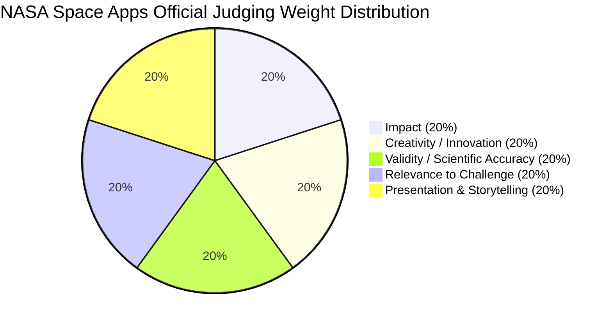

# OFFWORLD: NASA Space Apps Competition Rules, Judging & Submission Blueprint

**Subject:** Global Rules, Submission Standards, Judging Metrics & Hackathon Compliance  
**Event Window:** 48-Hour Hackathon Period  
**Document Classification:** Primary Strategic & Compliance Reference  

---

## 1. Official NASA Space Apps Global Competition Framework

The **NASA International Space Apps Challenge** is the world’s largest annual global hackathon, organized by NASA’s Earth Science Division in collaboration with international space agencies (ESA, JAXA, CSA, CNES, etc.).

### 1.1 Team Composition & Eligibility
- **Team Size:** $1\text{ to }6$ individuals. (Interdisciplinary teams combining coders, planetary researchers, UX designers, and storytellers historically score highest).
- **Participation:** Open globally to all backgrounds and skill levels.
- **Registration:** Every team member must be registered on the official `spaceappschallenge.org` platform and linked to the same team workspace.

---

## 2. Pre-Event Preparation Boundaries: What is Allowed vs. Prohibited

To ensure fair competition and protect against disqualification, the boundary between pre-hackathon preparation and active development must be strictly maintained:

| Activity | Permitted Pre-Event? | Official Competition Status & Notes |
| :--- | :---: | :--- |
| **Scientific & Mission Research** | **YES** | Gathering mission dates, landing coordinates, and PDS links is encouraged. |
| **Dataset & API Discovery** | **YES** | Identifying NASA Trek WMTS endpoints, HiRISE links, and 3D CAD files is permitted. |
| **System Architecture Design** | **YES** | Planning the React + OpenLayers + Three.js technology stack and state flow. |
| **UI/UX Wireframing** | **YES** | Creating paper sketches or Figma design mockups prior to kickoff is allowed. |
| **Pre-Writing Project Code** | **STRICTLY FORBIDDEN** | Writing custom application code, components, or styles before the hackathon starts is prohibited. |
| **Pre-Building Web Application**| **STRICTLY FORBIDDEN** | Deploying a live staging version of the specific project before the start time is a disqualifying violation. |
| **Pre-Existing Open Source Tools**| **YES** | Standard public npm libraries (e.g. `three`, `ol`, `framer-motion`) and templates are permitted. |

---

## 3. Official Judging Criteria & Scoring Strategy

Submissions advancing from local judging to global evaluation are scored by a panel of NASA scientists, engineers, and educators using five core criteria:

### 3.1 Alignment Strategy for OFFWORLD

#### 1. Impact (20%)
- *Question:* Does the project solve a real problem or educate the public on a critical space issue?
- *OFFWORLD Pitch:* Most public attention is absorbed by active rovers, while humanity's mechanical heritage on the Moon and Mars is forgotten. OFFWORLD acts as the world’s first open-access digital heritage monument for off-world archaeology, preserving science and inspiring future lunar/Martian explorers.

#### 2. Creativity & Innovation (20%)
- *Question:* How original is the approach? Does it take an unexpected creative angle?
- *OFFWORLD Pitch:* Rather than a dry scientific dashboard or a generic satellite map, OFFWORLD fuses rigorous planetary cartography with cinematic documentary storytelling and emotional audio landscapes ("The Last Signal").

#### 3. Validity & Scientific Accuracy (20%)
- *Question:* Is the solution scientifically sound? Does it correctly utilize NASA and partner open data?
- *OFFWORLD Pitch:* 100% of spatial coordinates, elevation models, traverse waypoints, Pancam imagery, and seismic audio traces derive directly from verified NASA PDS, HiRISE, and Solar System Treks archives. Every claim is cross-referenced with peer-reviewed literature.

#### 4. Relevance (20%)
- *Question:* How directly does the project respond to the challenge statement?
- *OFFWORLD Pitch:* Connects directly to planetary exploration, planetary history, open data accessibility, and immersive public outreach challenges.

#### 5. Presentation (20%)
- *Question:* How effectively does the team communicate their idea through their 7-slide deck or 2-minute video?
- *OFFWORLD Pitch:* A polished, cohesive visual identity, solemn documentary tone, high-contrast typography, and live functional WebGL/GIS demonstrations.

---

## 4. Artificial Intelligence (AI) Policy & Disclosure Rules

NASA Space Apps permits the use of modern development tools, including AI assistants, subject to strict integrity rules:

1. **Mandatory Disclosure:** Teams that utilize generative AI tools (such as Gemini, ChatGPT, Claude, GitHub Copilot, Midjourney, or ElevenLabs) must explicitly state how they were used in the project submission form.
2. **Human Originality & Defense:** The core idea, code architecture, and presentation must be directed, authored, and defendable by the team members. Submissions consisting of raw, unedited AI output without demonstrable team effort are heavily penalized.
3. **Intellectual Property Safety:** Generated media or code must not infringe upon third-party trademarks, copyrighted art, or commercial sound libraries.
4. **Factual Integrity:** Generative text must be fact-checked against authentic NASA documentation to prevent AI hallucinations of non-existent mission events.

---

## 5. Mandatory Hackathon Deliverables Checklist

Every team must submit the following through the official portal before the final deadline:

- [ ] **Project Title & Tagline:**  
  *OFFWORLD — The Forgotten Missions Archive*  
  *"Every mission ends. Its discoveries remain."*
- [ ] **Short Project Description:** High-impact $100\text{--}150$ word executive summary.
- [ ] **Public Code Repository URL:** Public GitHub/GitLab link containing an open-source license (MIT, Apache 2.0, or BSD) and comprehensive `README.md`.
- [ ] **Live Working Demo URL:** Active Vercel / Netlify / GitHub Pages deployment link.
- [ ] **7-Slide Presentation Deck OR 2-Minute Demonstration Video:**  
  *Recommendation:* Produce a high-energy **2-minute video** uploaded to YouTube (Unlisted or Public). Videos consistently engage judges more effectively than static slide decks.
- [ ] **NASA Open Data Citation List:** Explicit listing of every NASA dataset, WMTS tile layer, PDS volume, and photojournal entry utilized.

---

## 6. Two-Minute Video Pitch Script & Storyboard

A compelling video pitch follows a strict, disciplined timeline:

| Timecode | Visual Screen Action | Audio / Spoken Voiceover |
| :--- | :--- | :--- |
| **0:00 – 0:20** *(Hook)* | Dramatic slow pan across dark Martian plains. Faint telemetry beeps. Cut to silent Opportunity rover deck covered in red dust. | *"Right now, on the freezing deserts of Mars and the vacuum plains of the Moon, dozens of humanity's greatest explorers stand completely silent. Their wheels frozen. Their batteries dead. Forgotten."* |
| **0:20 – 0:50** *(The Solution)* | Reveal OFFWORLD interface: Smooth 3D planetary globe spinning. User clicks Opportunity; camera swoops into high-resolution HiRISE orbital imagery and reveals the 45-km traverse polyline. | *"This is OFFWORLD. The world’s first cinematic planetary archive dedicated to our abandoned mechanical pioneers. Built with NASA Solar System Treks WMTS layers, HiRISE 25-centimeter imaging, and PDS engineering logs."* |
| **0:50 – 1:20** *(Deep Dive / Feature)* | User clicks Pancam mast on 3D rover model to view hematite blueberries. Transition into "The Last Signal" interactive feature: atmospheric dust storm opacity gauge spikes, power collapses, Sol 5111 corrupted image renders. | *"Users don't just read history; they inspect the machines down to each seized actuator, explore exact sol-by-sol waypoints, and experience 'The Last Signal'—re-living the final moments when alien storms swallowed our rovers."* |
| **1:20 – 1:45** *(Scientific Validity)* | Split screen showing real PDS CSV coordinates, OpenLayers custom IAU2000 GIS projection, and authentic InSight Martian wind audio waveform. | *"Every coordinate is verified. Every audio track was recorded on another planet. Every photograph was beamed across millions of miles of deep space."* |
| **1:45 – 2:00** *(Call to Action & Close)* | Final cinematic pull-back into space showing the lonely Earth in the distance. Logo title reveals: OFFWORLD. | *"Every mission ends. Its discoveries remain. Explore the forgotten at offworld-archive.nasa."* |
