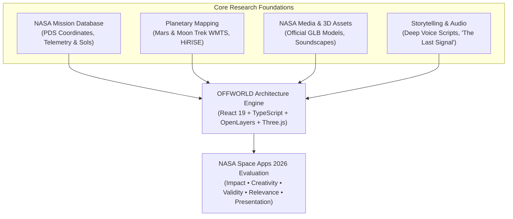

# OFFWORLD: Master Research Report & Hackathon Strategy

**Project:** OFFWORLD — The Forgotten Missions Archive  
**Tagline:** *"Every mission ends. Its discoveries remain."*  
**Hackathon Target:** NASA International Space Apps Challenge 2026 (November 14–15, 2026)  
**Document Status:** Final Executive Synthesis & Strategic Master Plan  
**Classification:** Master Operational Blueprint  

---

## 1. Executive Summary & Project Vision

### 1.1 The Concept
While active missions like Curiosity, Perseverance, and the James Webb Space Telescope continually dominate global headlines, the Moon and Mars host an extraordinary, silent museum of humanity’s mechanical pioneers. Dozens of rovers, stationary landers, and descent stages remain exactly where their operational lifespans ended—frozen in alien dust, preserved under vacuum and thin carbon dioxide atmospheres.

**OFFWORLD** is an immersive, cinematic, web-based digital heritage archive and interactive planetary explorer. It allows users to:
1. **Explore the Planetary Surface:** Navigate a realistic, Google Maps-style explorer of Mars and the Moon powered by authentic NASA orbital cartography.
2. **Inspect the Abandoned Hardware:** Examine scientifically accurate 3D models of rovers and landers, inspecting component failures (e.g., Spirit's seized wheel, Opportunity's degraded flash memory).
3. **Experience "The Last Signal":** Relive the final documented communications, declining battery voltages, choking dust storms, and the silent vigil of NASA's Deep Space Network through authentic telemetry, real photography, and actual alien acoustic recordings.

### 1.2 Target Missions
- **Opportunity (MER-B):** The 15-year marathoner of Meridiani Planum that drove 45.16 km, found hematite blueberries and gypsum veins, and went silent during the historic 2018 planet-encircling dust storm.
- **Spirit (MER-A):** The pioneer of Gusev Crater whose broken right-front wheel accidentally excavated 90% pure hydrothermal silica—proving ancient hot springs—before succumbing to the sand trap at "Troy".
- **InSight:** The stationary geophysical stethoscope on Elysium Planitia that recorded 1,318 marsquakes and humanity's first audio of Martian wind before its dust-coated solar arrays expired in late 2022.
- **Surveyor 3:** The robotic lunar scout of Oceanus Procellarum that landed in 1967 and was visited 31 months later by Apollo 12 astronauts Pete Conrad and Alan Bean, who brought its camera back to Earth.

---

## 2. Research Synthesis Across Key Domains



### 2.1 Domain 1: NASA Mission Science & Telemetry
- **Coordinates & Datums:** Every site is mapped to authoritative planetary coordinate reference systems: IAU 2000 Mars Planetocentric Sphere ($R = 3,396,190\text{ m}$) and Lunar Mean Earth/Polar Axis (ME) frame.
- **Fact vs. Myth Verification:** The popular internet claim that Opportunity spoke the English phrase *"My battery is low and it's getting dark"* was thoroughly investigated and debunked. Opportunity broadcasted binary telemetry packets reporting severe bus voltage drop, clock drift, $\tau > 10.8$, and a frame-clipped Pancam exposure; the phrase was a poetic journalistic summary. OFFWORLD presents the actual raw engineering telemetry alongside its poetic cultural impact.
- **Scientific Breakthroughs:** Each mission dossier documents verifiable physical evidence of past water, internal planetary geophysics, or lunar surface mechanics.

### 2.2 Domain 2: Planetary Mapping & Tile Services
- **Service Endpoints:** NASA Solar System Treks operates open OGC-compliant WMTS tile endpoints:
  - Mars: `https://trek.nasa.gov/tiles/Mars/EQ/{LayerName}/1.0.0/default/default028mm/{z}/{y}/{x}.jpg`
  - Moon: `https://trek.nasa.gov/tiles/Moon/EQ/{LayerName}/1.0.0/default/default028mm/{z}/{y}/{x}.jpg`
- **Orbital Resolution Hierarchy:** Macro global views leverage MOLA 463 m/px shaded relief and LRO WAC 100 m/px mosaics. Micro landing site views nest MRO HiRISE (25–30 cm/px) and LRO NAC (0.5 m/px) orthorectified imagery.
- **GIS Engine Recommendation:** **OpenLayers 10+** is the optimal 2D map canvas because it natively supports custom non-terrestrial projections and custom tile grids without the rigid Web Mercator (EPSG:3857) assumptions of Leaflet.

### 2.3 Domain 3: 3D Models & Authentic Media
- **NASA 3D Assets:** Official, free, public-domain `.glb` models for Opportunity, Spirit, InSight, and Apollo Lunar Module are cataloged from NASA Science 3D and NASA-3D-Resources.
- **Sound Design with Authentic Planetary Audio:** Rather than synthesized fictional sound effects, OFFWORLD utilizes real acoustic vibrations of Martian wind recorded by InSight's SEIS and APSS instruments on December 1, 2018, and authentic Apollo 12 air-to-ground radio transmissions from the Moon.
- **Cinematic Scores:** Fully copyright-compliant ambient sound beds curated from Incompetech (Kevin MacLeod CC-BY 4.0), Musopen (Public Domain), and FreeSound (CC0). Strict avoidance of copyrighted film music.

### 2.4 Domain 4: Front-End Architecture & WebGL Feasibility
- **Stack:** React 19 + TypeScript + Vite + Tailwind CSS + Three.js + OpenLayers + Framer Motion.
- **Resilience Against API Limits:** In a hackathon, relying on live queries to `api.nasa.gov` or live remote tile streaming poses catastrophic failure risks (rate limits, CORS blocks, Wi-Fi latency during judging). OFFWORLD mitigates this by packaging verified static GeoJSON trajectories and pre-cached base tiles locally, using remote endpoints only as dynamic progressive enhancements.

---

## 3. Mission Readiness & Risk Matrix

| Risk Factor | Impact | Probability | Mitigation Strategy Enforced |
| :--- | :---: | :---: | :--- |
| **NASA Tile Server Throttling or CORS Rejection** | High | Medium | Pre-cache Zoom 0–3 global basemaps and localized HiRISE cutout textures inside the repository `/public/` assets. |
| **WebGL Performance Lag on Evaluator Hardware** | High | Low | Apply Draco compression to 3D models; keep polygon counts $< 50\text{k}$ tris; cap texture sizes at $2048 \times 2048$ WebP. |
| **Browser Audio Autoplay Policies Blocking Sound** | Medium | High | Require an explicit user interaction ("Initialize Audio Uplink") on the welcome splash screen before unlocking the Web Audio Context. |
| **Scope Creep During 48-Hour Development** | Critical | High | Implement a strict MVP feature freeze at Hour 36, reserving the final 12 hours for testing, polish, and video production. |
| **Disqualification for Pre-Building Code** | Fatal | Zero | Maintain strict adherence to NASA Space Apps rules: all code will be written during November 14–15; only research and planning conducted pre-event. |

---

## 4. Prioritized 48-Hour Hackathon MVP Scope

To maximize scoring under the five official NASA judging criteria (Impact, Creativity, Validity, Relevance, Presentation), the team must focus on high-impact features and ruthlessly eliminate low-value complexity:

```text
========================================================================================
OFFWORLD 48-HOUR HACKATHON MVP SCOPE CLASSIFICATION
========================================================================================

[MUST HAVE - CORE MVP - COMPLETE BY HOUR 30]
----------------------------------------------------------------------------------------
1. Interactive 3D Planetary Globe (Three.js): Smooth rotating Mars and Moon spheres 
   with clickable mission landing site pins.
2. Smooth Camera Zoom: Transition from orbit down to local planetary surface map.
3. OpenLayers Surface Map: HiRISE/MOLA tiles displaying Opportunity's 45-km traverse route
   and Spirit's path to Home Plate.
4. Curated Rover Dossiers: Complete scientific records, discovered minerals, and sol timeline.
5. "The Last Signal" Chapter: Dedicated modal screen for Opportunity (Sol 5111) and 
   InSight (Sol 1445) showing telemetry collapse, final images, and DSN logs.
6. Authentic Audio Engine: Background Martian wind and telemetry clicks enabled via Web Audio.

[SHOULD HAVE - SECONDARY POLISH - COMPLETE BY HOUR 40]
----------------------------------------------------------------------------------------
1. Three.js Interactive 3D Rover Viewer: Rotate/zoom the 3D rover model with clickable 
   hotspots on key instruments (Pancam, Seized Wheel, Robotic Arm).
2. Deep Voice Narration: Synchronized playback of the 60-second documentary scripts.
3. CRT / Telemetry Visual Filters: Retro mission control scanline shader effects.
4. Sol-by-Sol Scrubbing Timeline: Interactive slider moving the rover along its route.

[COULD HAVE - STRETCH GOALS - ONLY IF TIME PERMITS]
----------------------------------------------------------------------------------------
1. VR / Stereoscopic View Mode for mobile devices.
2. Real-time sun angle lighting calculations based on Mars ephemeris.
3. Full audio sonification synthesizer for custom user-selected marsquakes.

[DO NOT BUILD - STRICT CUT LIST]
----------------------------------------------------------------------------------------
- Complex user login, authentication, or backend databases (pure client-side static app).
- Live API queries to api.nasa.gov during runtime (use local static JSON).
- Procedural terrain generation or volumetric physics simulations (use real NASA DTMs).
========================================================================================
```

---

## 5. Team Roles & Execution Workflow for November 14–15

A balanced four-person hackathon team should partition responsibilities as follows:

| Team Role | Core Responsibility During Hackathon | Primary Tools & Deliverables |
| :--- | :--- | :--- |
| **Lead Front-End & GIS Engineer** | OpenLayers planetary canvas, custom IAU2000 projections, WMTS tile caching, GeoJSON traverse rendering | TypeScript, OpenLayers 10, Vite, Tailwind CSS |
| **3D Graphics & WebGL Developer** | Three.js globe sphere, Draco glTF rover loader, camera lerping transitions, PBR shaders | Three.js, React Three Fiber, GLSL, Blender |
| **Audio & Narrative Producer** | Documentary voiceover synthesis, Web Audio spatial engine, sound effect mixing, pitch deck / video creation | ElevenLabs, Audacity, Web Audio API, DaVinci / Premiere |
| **Mission Data & Research Specialist** | Data validation, GeoJSON compilation, NASA citations register, Space Apps submission text & documentation | NASA PDS, QGIS, Markdown, GitHub Documentation |

---

## 6. Pre-Kickoff Checklist (Before November 14, 2026)

Before the hackathon opens, team members should ensure the following non-coding preparation is complete:
1. **Team Registration:** Ensure all team members have joined the project team on `spaceappschallenge.org`.
2. **Review Dossiers:** Familiarize all team members with the contents of the `research/` folder.
3. **Asset Verification:** Verify that 3D model files (`.glb`) and audio clips (`.webm`/`.mp3`) can be downloaded smoothly and placed in readiness for import once the hackathon clock starts.
4. **Development Environment:** Ensure Node.js (v20+), npm/pnpm, and Git are updated on all development laptops.
5. **Pitch Video Script Rehearsal:** Review the 2-minute video pitch storyboard in `COMPETITION_RULES_AND_SUBMISSION.md` so recording can take place smoothly on Day 2.

---

## 7. Research Deliverables Index

The complete OFFWORLD research corpus is organized into the following eight interconnected documents located in the `research/` directory:

1. [MASTER_RESEARCH_REPORT.md](file:///c:/Users/charm/Downloads/NASA%20Space%20app%20docs/research/MASTER_RESEARCH_REPORT.md) — *This Executive Synthesis and Strategic Roadmap.*
2. [NASA_MISSION_DATABASE.md](file:///c:/Users/charm/Downloads/NASA%20Space%20app%20docs/research/NASA_MISSION_DATABASE.md) — *Complete scientific dossiers, coordinates, traverses, and telemetry records for Opportunity, Spirit, InSight, and Surveyor 3.*
3. [PLANETARY_MAPPING_RESEARCH.md](file:///c:/Users/charm/Downloads/NASA%20Space%20app%20docs/research/PLANETARY_MAPPING_RESEARCH.md) — *Planetary GIS architectures, NASA Mars/Moon Trek WMTS REST endpoints, OpenLayers projection configurations, and HiRISE/LRO datasets.*
4. [NASA_MEDIA_AND_3D_RESOURCES.md](file:///c:/Users/charm/Downloads/NASA%20Space%20app%20docs/research/NASA_MEDIA_AND_3D_RESOURCES.md) — *Official glTF/GLB models, Photojournal links, authentic InSight Martian wind recordings, Apollo 12 voice tapes, and licensing standards.*
5. [TECHNICAL_FEASIBILITY.md](file:///c:/Users/charm/Downloads/NASA%20Space%20app%20docs/research/TECHNICAL_FEASIBILITY.md) — *React 19 / TypeScript / OpenLayers / Three.js technical evaluation, rate limit mitigation, WebGL memory budgets, and 48-hour development schedule.*
6. [CINEMATIC_STORYTELLING_RESOURCES.md](file:///c:/Users/charm/Downloads/NASA%20Space%20app%20docs/research/CINEMATIC_STORYTELLING_RESOURCES.md) — *Documentary narrative framework, four original narration scripts, sound design architecture, and "The Last Signal" UI/UX blueprint.*
7. [COMPETITION_RULES_AND_SUBMISSION.md](file:///c:/Users/charm/Downloads/NASA%20Space%20app%20docs/research/COMPETITION_RULES_AND_SUBMISSION.md) — *NASA Space Apps global rules, judging criteria breakdown, AI disclosure policy, and 2-minute pitch video script.*
8. [SOURCE_REGISTER.md](file:///c:/Users/charm/Downloads/NASA%20Space%20app%20docs/research/SOURCE_REGISTER.md) — *Exhaustive 28-entry citation index with direct URLs, data support scopes, and verification status.*
