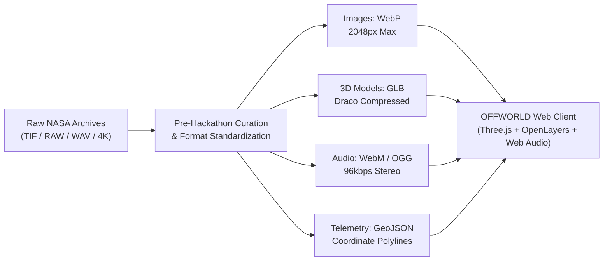

# OFFWORLD: NASA Media, 3D Assets & Audio Inventory

**Archive Subject:** Primary Media, Spatial Assets, Scientific Imagery & Sound Recordings  
**Missions:** Opportunity (MER-B), Spirit (MER-A), InSight, Surveyor 3 / Apollo 12  
**Status:** Complete Asset Catalog & Integration Guide  
**Document Classification:** Primary Technical Reference  

---

## 1. NASA Media Usage & Legal Framework

### 1.1 Public Domain & Licensing Status
As an agency of the United States Federal Government, NASA media (imagery, video, audio recordings, and 3D models) is generally **not protected by copyright in the United States** and may be used for educational, informational, and non-commercial projects under **NASA Media Usage Guidelines**:
- **Official Policy:** NASA Regulations 14 CFR 1212 / NASA Policy Directive (NPD) 1387.1.
- **Commercial Restrictions:** NASA logos, emblems, and insignia (the "meatball" and the "worm") cannot be used to endorse a commercial product or project without express permission.
- **Attribution Requirement:** NASA content must be accurately credited to NASA, the responsible Jet Propulsion Laboratory (JPL), or the specific instrument university team.
- **Strict Authenticity Mandate for OFFWORLD:**  
  *Never present synthetic, AI-generated, or artistically reconstructed imagery as authentic NASA photographic evidence.* All historical telemetry and imagery within OFFWORLD must maintain clear provenance tags.

---

## 2. Rover & Lander 3D Asset Repository

NASA publishes official CAD-derived and artist-optimized 3D models through the **NASA 3D Resources Portal** (`nasa3d.arc.nasa.gov`) and the modern **NASA Science 3D Hub** (`science.nasa.gov/3d-resources/`).

### 2.1 3D Model Catalog for Target Missions

| Mission / Asset Name | Official NASA Asset ID | Available Formats | Polygon Count | File Size | Direct Official Source |
| :--- | :--- | :--- | :--- | :--- | :--- |
| **Mars Exploration Rover (Opportunity / Spirit)** | `mer-b-opportunity` / `mer-a-spirit` | `.glb`, `.gltf`, `.obj`, `.usdz` | ~45,000 tris | 8.4 MB (GLB) | [NASA Science 3D: Opportunity](https://science.nasa.gov/3d-resources/) |
| **InSight Mars Lander (Deployed Configuration)** | `insight_lander_deployed` | `.glb`, `.gltf`, `.obj`, `.stl` | ~62,000 tris | 12.1 MB (GLB) | [NASA Science 3D: InSight](https://science.nasa.gov/3d-resources/) |
| **Surveyor Lunar Lander** | `surveyor-3-lunar-lander` | `.obj`, `.stl`, `.gltf` (NASA-3D repo) | ~28,000 tris | 5.2 MB (OBJ/GLB) | [NASA-3D-Resources GitHub](https://github.com/nasa/NASA-3D-Resources) |
| **Apollo 12 Lunar Module (Intrepid)** | `apollo-12-lunar-module` | `.glb`, `.obj` | ~38,000 tris | 7.9 MB (GLB) | [NASA Science 3D: Apollo](https://science.nasa.gov/3d-resources/) |
| **Block Island Meteorite (Found by Opportunity)** | `opportunity-block-island` | `.obj`, `.stl` | ~18,000 tris | 3.5 MB | [NASA JPL 3D Models](https://nasa3d.arc.nasa.gov/) |

### 2.2 Three.js Model Optimization & Loading Specification
To achieve fast 60 FPS loading in a web browser without memory strain:
- **Format Choice:** Use **glTF Binary (`.glb`)** with **Draco Geometry Compression**. This reduces payload size by $60\text{ to }75\%$.
- **Texture Budgets:** Diffuse, Normal, and Roughness/Metallic maps should be compressed to $2048 \times 2048$ WebP or Basis Universal format.
- **Three.js Implementation Pattern:**

```typescript
import { GLTFLoader } from 'three/examples/jsm/loaders/GLTFLoader';
import { DRACOLoader } from 'three/examples/jsm/loaders/DRACOLoader';

const dracoLoader = new DRACOLoader();
dracoLoader.setDecoderPath('/draco/');

const gltfLoader = new GLTFLoader();
gltfLoader.setDRACOLoader(dracoLoader);

// Load the official Opportunity Rover GLB
gltfLoader.load('/models/opportunity_rover.glb', (gltf) => {
  const model = gltf.scene;
  model.traverse((child) => {
    if ((child as THREE.Mesh).isMesh) {
      child.castShadow = true;
      child.receiveShadow = true;
    }
  });
  scene.add(model);
});
```

---

## 3. Authentic NASA Audio Archives & Soundscapes

A cornerstone of OFFWORLD’s emotional resonance is authentic acoustic recordings captured on alien worlds or during historical deep-space transmissions.

### 3.1 InSight: First Authentic Sounds of Mars
InSight provided humanity’s first actual acoustic recordings from the surface of Mars, captured using its seismometer (SEIS) and pressure sensor (APSS):
- **Martian Wind (Dec 1, 2018):** Low-frequency rumbling wind ($10\text{--}15\text{ mph}$) vibrating InSight’s solar panels.
  - *Raw Frequency:* Sub-audible infrasound ($1\text{--}5\text{ Hz}$).
  - *NASA Sonified Audio:* Pitched up two octaves by JPL to make it audible to the human ear.
  - *Direct URL:* [NASA InSight Sounds of Mars](https://mars.nasa.gov/insight/multimedia/sounds-of-mars/)
- **Marsquake S0173a & Monster Quake S1222a (May 4, 2022):** Deep acoustic reverberations resonating through the Martian mantle.
- **Dust Devil Passes:** Whistling pressure drop vortices captured by the APSS pressure sensor.

### 3.2 Apollo 12 / Surveyor 3: Voice Tapes from the Lunar Surface
Historical air-to-ground audio logs between Apollo 12 astronauts Pete Conrad, Alan Bean, and Houston CAPCOM (Dr. Edward Gibson):
- **Date:** November 20, 1969 (EVA 2).
- **Key Dialogues:**
  - *Conrad (approaching the rim of Surveyor Crater):* "Hey, there it is! Right on the edge of the crater! It looks like it's in great shape!"
  - *Bean (inspecting color changes):* "Look at that, Pete... the side facing the sun is brown, and the back side is still white!"
  - *Conrad (clipping the TV camera):* "Okay, camera's coming loose... we got the scoop!"
- **Direct Source:** NASA Johnson Space Center History Office & [Apollo Lunar Surface Journal (ALSJ)](https://www.hq.nasa.gov/alsj/a12/a12.html). Available in uncompressed `.wav` and `.mp3` formats.

### 3.3 The Final Opportunity Wakeup Song
- **Historical Audio Event:** On the evening of February 12, 2019, JPL Flight Control played Billie Holiday’s classic recording of *"I’ll Be Seeing You"* as the final transmission beamed to Meridiani Planum via the Goldstone DSN antenna.
- **JPL Mission Control Livestream Recording:** February 13, 2019 retirement press briefing, containing Project Manager John Callas's emotional final tribute.
- **NASA Official SoundCloud:** [SoundCloud - NASA Official Sound Library](https://soundcloud.com/nasa). Contains over 60 public-domain space audio clips.

---

## 4. Curated Photographic Archives & Gigapixel Panoramas

### 4.1 Opportunity (MER-B)
- **NASA Photojournal ID `PIA15689`:** *The Greeley Panorama*  
  - Taken from Cape Tribulation, Endeavour Crater. A 360-degree, 1.2-gigapixel composite comprising over 817 individual Pancam exposures taken between Sol 2811 and Sol 2947.
  - High-res format: TIFF ($18,000 \times 4,500$ px), JPEG preview.
- **NASA Photojournal ID `PIA22222`:** *Opportunity's Final Incomplete Pancam Image (Sol 5111)*  
  - The actual last image transmitted by Opportunity before the global dust storm swallowed the rover. Shows a dark, frame-clipped, noise-filled frame pointing toward the blackened sun.
- **NASA Raw Image Browser:**  
  `https://mars.nasa.gov/mer/gallery/all/opportunity.html`  
  Indexed by Sol, Instrument (Pancam, Navcam, Hazcam, Microscopic Imager), and Camera Eye (Left/Right stereo pairs).

### 4.2 Spirit (MER-A)
- **NASA Photojournal ID `PIA11234`:** *The McMurdo Panorama*  
  - Full-color 360-degree cylindrical composite captured while wintering at the Home Plate platform.
- **NASA Photojournal ID `PIA09249`:** *Silica-Rich Soil Excavation at Home Plate*  
  - Shows the bright white trench excavated by Spirit’s locked right-front wheel on Sol 1152.
- **NASA Raw Image Browser:**  
  `https://mars.nasa.gov/mer/gallery/all/spirit.html`

### 4.3 InSight
- **NASA Photojournal ID `PIA25624`:** *InSight's Final Photograph on Mars (Sol 1438 / Sol 1445)*  
  - Shows the dust-coated Instrument Deployment Arm, the seismometer dome (WTS), and the sunlit horizon of Elysium Planitia, taken December 11, 2022.
- **NASA Raw Image Browser:**  
  `https://mars.nasa.gov/insight/multimedia/raw-images/`

### 4.4 Surveyor 3 & Apollo 12
- **Apollo Lunar Surface Journal (ALSJ) Photography Catalog:**
  - `AS12-48-7098`: Pete Conrad standing next to Surveyor 3 with the Apollo 12 Lunar Module visible on the crater rim in the background. (One of the most famous space photographs in history).
  - `AS12-48-7133`: Close-up of Surveyor 3’s footpad and surface sampler scoop showing trench lines in the lunar regolith.
  - `AS12-48-7136`: Close-up of the TV camera before removal.
- **USGS Surveyor 3 Digitized Circular Panorama:**
  - 360-degree polar mosaic assembled from 6,315 television scans transmitted in April/May 1967.
  - Source: [USGS Astrogeology Surveyor Catalog](https://astrogeology.usgs.gov/).

---

## 5. Curated Mission Video & Historical Footage

| Sequence | Historical Content | Format | Source / Location |
| :--- | :--- | :--- | :--- |
| **Apollo 12 16mm DAC Film** | Pete Conrad and Alan Bean walking down into Surveyor Crater and inspecting the lander | 1080p Digitized MP4 | NASA Archives / National Archives Record Group 255 |
| **InSight Lander Separation & Landing Animation** | Engineering animation of EDL and SEIS dome deployment | 4K ProRes / MP4 | NASA Scientific Visualization Studio (SVS) ID 13072 |
| **Spirit Dust Devil Time-Lapse** | Real photographic animation of swirling dust devils scudding across Gusev Crater | Animated GIF / WebM | NASA JPL Photojournal `PIA03230` |
| **Phobos Solar Eclipse from Mars** | Opportunity Pancam real-time capture of the potato-shaped Martian moon transit across the Sun | MP4 / GIF | NASA Photojournal `PIA05558` |
| **Opportunity 15-Year Commemorative** | Official retrospective video documentary summarizing the 15-year traverse | 1080p MP4 | NASA JPL YouTube Official Archive |

---

## 6. Media Pipeline & Asset Optimization Plan

To keep the web application light, responsive, and deployable within hackathon constraints:


