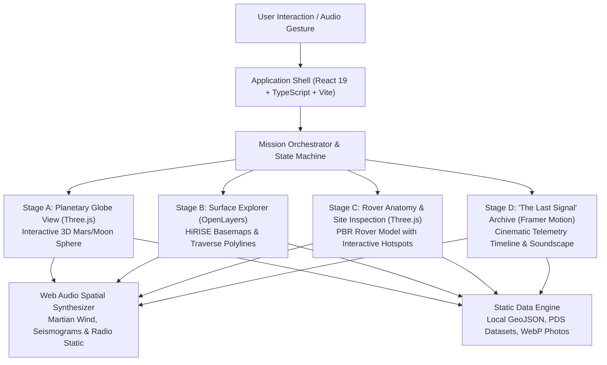

# OFFWORLD: Technical Feasibility, Architecture & Risk Assessment

**Archive Subject:** Front-End Architecture, WebGL Graphics, API Resilience & 48-Hour Hackathon Blueprint  
**Technology Stack:** React 19 / TypeScript / Vite / Three.js / OpenLayers / Framer Motion / Web Audio API  
**Status:** Complete Architectural Specification  
**Document Classification:** Primary Technical Reference  

---

## 1. Executive Feasibility Assessment

Building a Google Maps-like planetary explorer combined with a 3D rover model viewer and documentary narrative engine within a 48-hour hackathon window is **entirely feasible**, provided strict architectural constraints and pre-planned data pipelines are enforced.

### Feasibility Scorecard:
| Dimension | Feasibility Rating | Primary Bottleneck / Risk | Mitigation Strategy |
| :--- | :---: | :--- | :--- |
| **2D Planetary Tile Map** | **High (8.5/10)** | Projection distortion on custom Mars/Moon spheroids; remote Trek tile server latency | Use OpenLayers with custom `IAU2000` projection; pre-cache local tile fallbacks |
| **3D Planetary Globe View** | **Very High (9.5/10)** | Shading, atmospheric rim glow, frame-rate dips on mobile | Lightweight Three.js `SphereGeometry` with 2K PBR textures and custom atmosphere vertex shader |
| **3D Rover Model Inspection** | **High (8.0/10)** | Large NASA 3D CAD files causing long load times or WebGL crashes | Compress NASA `.glb` files using Draco compression down to $< 10\text{ MB}$; enforce strict polygon budgets |
| **Cinematic UI & Transitions** | **Very High (9.0/10)** | Layout shifts and stuttering animations | Framer Motion layout transitions + Tailwind CSS hardware-accelerated transforms |
| **Audio & Ambient Narrative** | **Very High (9.5/10)** | Browser autoplay policies blocking sound before user gesture | Implement interactive "Initialize Audio Transmission" button on welcome screen |
| **Live Remote NASA APIs** | **Moderate / High Risk (5.0/10)** | Rate limits, CORS blocks, unexpected downtime on `api.nasa.gov` or `trek.nasa.gov` | **Do not rely on live dynamic queries during judging.** Bundle pre-extracted, verified GeoJSON & telemetry locally |

---

## 2. Core Technology Stack Architecture



---

## 3. Detailed Component Evaluation

### 3.1 Front-End Framework: React 19 + TypeScript + Vite
- **Advantages:** Instant HMR (Hot Module Replacement) with Vite ensures rapid prototyping during the 48-hour event. TypeScript provides compile-time guarantees for complex telemetry schemas and GeoJSON coordinate models.
- **Component Breakdown:**
  - `GlobeViewer.tsx`: Three.js canvas hosting the celestial sphere.
  - `PlanetaryMap.tsx`: OpenLayers wrapper hosting high-resolution local/remote tiles.
  - `ModelInspector.tsx`: Three.js canvas with OrbitControls and annotated hotspots.
  - `LastSignalModal.tsx`: Framer Motion overlay simulating mission control terminal readout.
  - `SoundtrackManager.ts`: Global Web Audio API singleton.

### 3.2 2D Planetary GIS Engine: OpenLayers 10+
- **Why OpenLayers over Leaflet:** Standard Leaflet has hardcoded assumptions regarding Earth's Web Mercator bounds (EPSG:3857). OpenLayers allows arbitrary projection definitions (`ol/proj/Projection`), coordinate extents ($-180^\circ$ to $+180^\circ$ or $0^\circ$ to $360^\circ$), and custom tile grids (`ol/tilegrid/WMTS`).
- **Tile Grid Calculation for Mars Trek:**
  ```typescript
  import { getTopLeft, getWidth } from 'ol/extent';
  import WMTSTileGrid from 'ol/tilegrid/WMTS';

  const marsExtent: [number, number, number, number] = [-180, -90, 180, 90];
  const resolutions = new Array(8);
  const matrixIds = new Array(8);
  const tileSize = 256;
  const initialResolution = getWidth(marsExtent) / tileSize;

  for (let z = 0; z < 8; ++z) {
    resolutions[z] = initialResolution / Math.pow(2, z);
    matrixIds[z] = z.toString();
  }

  export const marsTileGrid = new WMTSTileGrid({
    origin: getTopLeft(marsExtent),
    resolutions: resolutions,
    matrixIds: matrixIds,
    tileSize: [256, 256]
  });
  ```

### 3.3 3D Visualization: Three.js (r160+)
- **Macro Globe:** A `THREE.SphereGeometry(radius, 64, 64)` covered with a $4096 \times 2048$ equirectangular MOLA or Viking color map, normal map for crater relief, and a custom GLSL vertex shader simulating atmospheric Rayleigh scattering (reddish-tan for Mars, black/hard rim for the Moon).
- **Interactive Rover Model:** Loaded via `GLTFLoader` with `DRACOLoader`. Raycasting (`THREE.Raycaster`) enables clicking specific instruments (e.g., Opportunity’s Pancam mast, Spirit’s seized right-front wheel, InSight’s SEIS dome) to open documentary media cards.

### 3.4 Cinematic Animation: Framer Motion
- **Usage:** Handles the cinematic narrative overlays, fading between the cosmic space view and surface telemetry screens.
- **Performance Safeguard:** Use `transform` and `opacity` exclusively to ensure animations run on the GPU composite thread and never trigger DOM layout reflows during 3D WebGL rendering.

---

## 4. API Resilience, Rate Limits & Fallback Strategy

### 4.1 Remote NASA APIs Evaluation
- **`api.nasa.gov`:**  
  - Enforces a rate limit of **1,000 requests per hour** with a custom API key, and only **30 requests per minute** with the default `DEMO_KEY`.
  - *Risk:* In a competition setting where judges review the project simultaneously, the `DEMO_KEY` limit can be exhausted within seconds, crashing the UI.
  - *Architectural Recommendation:* **Do not execute live calls to `api.nasa.gov` in production.** NASA mission data for Opportunity, Spirit, InSight, and Surveyor 3 is completely historical and static. All necessary metadata, telemetry points, and photo catalog references should be stored in local static JSON bundles.
- **NASA Trek WMTS (`trek.nasa.gov`):**  
  - Open REST tile server without API key authentication.
  - *Risk:* Trek servers occasionally experience high latency, packet drops, or strict CORS preflight rejections if queried from certain origins.
  - *Architectural Recommendation:* Provide a robust local tile fallback:
    ```typescript
    // Tile loading error fallback
    tileImage.getImage().addEventListener('error', () => {
      // Substitute with pre-bundled offline tile
      tileImage.getImage().src = `/tiles/fallback/mars_z0.jpg`;
    });
    ```

---

## 5. WebGL Hardware Constraints & Performance Budget

To ensure smooth performance on typical hackathon presentation laptops and mobile devices:

| Metric | Target Budget | Hard Maximum Ceiling | Optimization Technique |
| :--- | :--- | :--- | :--- |
| **Total Initial Bundle** | $< 3.5\text{ MB}$ (gzipped) | $5.0\text{ MB}$ | Vite code-splitting; dynamic imports for Three.js and OpenLayers |
| **WebGL Texture Size** | $2048 \times 2048$ px | $4096 \times 4096$ px | Downscale 8K orbital maps; use WebP format |
| **Model Polygon Count** | $< 50,000$ triangles | $100,000$ triangles | Draco geometry compression; decimate CAD models in Blender |
| **Frame Rate** | **60 FPS** | Minimum 30 FPS | Pause Three.js render loop when 2D map view is active; use `requestAnimationFrame` conditionally |
| **Audio Memory Footprint**| $< 15\text{ MB}$ | $30\text{ MB}$ | Compress audio to 96 kbps Opus / WebM; stream long narrative voiceovers |

### Web Audio Autoplay Policy Compliance
Modern browsers block audio contexts from playing sounds until an explicit user interaction occurs:
```typescript
// SoundManager.ts
class AudioManager {
  private ctx: AudioContext | null = null;

  public async initialize(): Promise<void> {
    if (!this.ctx) {
      const AudioCtxClass = window.AudioContext || (window as unknown as { webkitAudioContext: typeof AudioContext }).webkitAudioContext;
      this.ctx = new AudioCtxClass();
    }
    if (this.ctx.state === 'suspended') {
      await this.ctx.resume();
    }
  }
}
export const soundManager = new AudioManager();
```

---

## 6. Recommended 48-Hour Hackathon Execution Roadmap

```text
========================================================================================
48-HOUR HACKATHON TIME ALLOCATION SCHEDULE
========================================================================================

HOURS 00 - 06: SCAFFOLDING & FOUNDATION
  - Initialize Vite + React 19 + TypeScript + Tailwind CSS workspace.
  - Establish static asset directories (/public/models, /public/audio, /public/data).
  - Convert mission telemetry into GeoJSON schemas.
  - Setup GitHub repository with CI/CD deployment to Vercel/Netlify.

HOURS 06 - 18: CORE ENGINES (PARALLEL WORK TRACKS)
  - Track 1 (GIS Lead): Build OpenLayers planetary canvas with Mars/Moon Trek WMTS.
  - Track 2 (3D Lead): Build Three.js globe viewer and Draco glTF rover loader.
  - Track 3 (Story & Content Lead): Assemble mission narrative scripts, photos & audio.

HOURS 18 - 30: INTEGRATION & INTERACTIVE HOTSPOTS
  - Connect globe marker clicks to zoom-into-map transition.
  - Mount 3D rover model viewer inside mission detail view.
  - Wire interactive hotspots on rover components (Pancam, Arm, Solar Arrays).
  - Implement Web Audio synthesizer for ambient wind and radio static.

HOURS 30 - 40: "THE LAST SIGNAL" & CINEMATIC POLISH
  - Build "The Last Signal" interactive timeline with Sol 5111 / Sol 1445 chapters.
  - Implement battery gauge depletion curve and signal loss audio distortion.
  - Add Framer Motion camera lerps, HUD scanlines, and crt-terminal visual effects.

HOURS 40 - 48: SUBMISSION DRILL, VIDEO & FINAL DEPLOYMENT
  - Freeze code at Hour 44!
  - Record 2-minute presentation demo video.
  - Write detailed project README with NASA data citations.
  - Complete official NASA Space Apps project submission form.
========================================================================================
```
